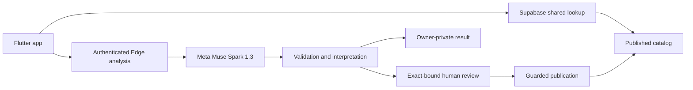

# Pickwell AI

**Scan the barcode. Understand the label.**

Pickwell AI turns packaged-food labels into understandable product information.
Built for shoppers in the Philippines, it brings nutrition facts, ingredient
explanations and their evidence together in one Flutter app.

The motivation is food-label transparency, informed by awareness of chronic kidney
disease (CKD) in the Philippines. Pickwell supports label awareness; it does not
provide a personalized renal diet, diagnosis, medical advice or a food-safety certificate.

## How it works

1. **Scan a barcode.** Guests can read a published shared result without signing in
   or making another AI call.
2. **Capture an unknown product.** Take three required photos in order:
   **Front packaging → Nutrition facts → Ingredients**. The barcode is already captured.
3. **Verify your email.** Supabase Email OTP protects new analysis; the draft survives
   the authentication interruption.
4. **Get a private result.** An authenticated Supabase Edge Function calls
   **Meta Muse Spark 1.3** (`muse-spark-1.3`) with the three images. The backend validates
   extraction and applies versioned interpretation rules before delivering an
   owner-private result.
5. **Share through review.** Product Trust requires an explicit human operator
   decision bound to the exact barcode, image digest, candidate and policy before
   publication. Subsequent barcode lookups reuse the canonical shared record.

Results distinguish observed product identity, printed nutrition facts, ingredient
explanations, source evidence and unknown values. Supported findings include reasons
and references rather than an overall health score. A readable label or confident
model response does not independently verify barcode ownership.

Approved products can have an optional front-package thumbnail. Protected operator
tooling creates a bounded JPEG derivative **after publication**; a private bucket
and eligibility-checking read endpoint keep pending images and originals nonpublic.
Products without an eligible image show a placeholder.

## Architecture



| Location | Responsibility |
| --- | --- |
| [`mobile/`](mobile/README.md) | Flutter iOS/Android; Bloc/Cubit, GoRouter, feature/domain/data layers, capture/retry state |
| [`supabase/`](supabase/README.md) | PostgreSQL migrations/RLS, Edge Functions, private results, quotas, publication and media boundaries |
| [`docs/`](docs/README.md) | Product specifications, architecture contracts, implementation and verification evidence |
| `web/`, `website/` | Inherited Next.js/Astro starters; not the hackathon's Flutter demo |

Muse is called server-side at `https://api.meta.ai/v1/chat/completions`. Flutter
contains no Meta or privileged Supabase key. Model output cannot authorize shared
writes, change quota rules or override deterministic acceptance checks.

## Run the Flutter app

Prerequisites: Git, FVM, the Flutter toolchain, and a configured emulator or device.
The documented baseline is **Flutter 3.47.7 / Dart 3.13.5**; `.fvmrc` follows
`stable`, so check the selected version. Android uses Java 17, minimum SDK 26 and
compile SDK 37 or newer. iOS requires macOS/Xcode, iOS 15+ and Swift Package Manager.

```sh
git clone https://github.com/StartAppLab/pickwell-ai.git
cd pickwell-ai/mobile
fvm install
fvm flutter pub get --enforce-lockfile
mkdir -p .secrets
cp config/pickwell.dev.example.json .secrets/dev.secrets
```

Set `SERVER_BASE_URL` to **your** Supabase URL and `SERVER_API_KEY` to its public
publishable/anon key. Keep the supplied optional auth, enabled backend, disabled
billing and deferred integrations. Configure Supabase Email OTP with numeric
`{{ .Token }}` delivery and the app callback allowlist. See
[environment setup](docs/PICKWELL_ENVIRONMENT_SETUP.md) and
[OTP implementation](docs/PICKWELL_EMAIL_OTP_GATE.md).

```sh
fvm flutter run --dart-define-from-file=.secrets/dev.secrets
```

The ignored JSON is embedded in the app: **public configuration only**. Never add
Meta keys, service-role keys, database passwords or signing credentials. Without
these defines the reusable framework starts in offline mode, not the connected
Pickwell flow. Example placeholders do not grant access to the owner's deployment.

## Backend development and deployment

Use the Supabase CLI (the recorded hosted checks used **2.122.0**) and Docker for a
disposable local stack. From repository root:

```sh
supabase start
cp supabase/.env.example supabase/.env.dev
```

Fill the ignored **server-only** file with authorized `META_API_KEY`,
`META_API_URL=https://api.meta.ai/v1/chat/completions`, `META_MODEL=muse-spark-1.3`
and a cryptographically random `PICKWELL_NETWORK_HASH_SECRET` of at least 32 bytes.
Supabase injects its reserved server credentials. Configure proxy attribution only
for verified ingress. Point Flutter at the local URL/public key; use the local
mail inbox for local OTP codes.

```sh
supabase functions serve --env-file supabase/.env.dev
supabase test db
```

Local startup applies `supabase/migrations/`. `supabase db reset` destroys local
state and belongs only on a disposable local stack. Inference admission is controlled
by server data; a Meta key alone does not enable it.

For your own hosted deployment, link the intended project, install its protected
server secrets, review pending migrations with `supabase db push --dry-run`, and
coordinate migrations with the compatible Edge handlers before distributing a new
client. Follow the [backend guide](supabase/README.md) and
[documented rollout](docs/PICKWELL_HOSTED_PRIVATE_RESULTS_ROLLOUT.md), including
endpoint JWT settings and protected operator setup. Do not replay historical
commands blindly against an existing deployment. This repository task deploys nothing.

## Testing

From `mobile/`, after dependency setup:

```sh
fvm flutter analyze --no-pub
fvm flutter test --no-pub test/catalog test/app_config_security_test.dart
python3 tool/check_environment.py --config .secrets/dev.secrets
fvm flutter build apk --debug --no-pub --dart-define-from-file=.secrets/dev.secrets
python3 tool/check_environment.py --config .secrets/dev.secrets --artifact build/app/outputs/flutter-apk/app-debug.apk
```

From root, run tooling checks with
`python3 -m unittest discover -s mobile/tool -p 'test_*.py'`; SQL checks use
`supabase test db` on the disposable local stack. Backend Node SQL fixtures require
the documented PGlite/native harness, and thumbnail tooling uses pinned
`supabase/scripts/thumbnail-requirements.txt`. See the
[verification report](docs/PICKWELL_SUBMISSION_READINESS.md) for exact prior results.
Mocks and SQL fixtures are not live Muse or physical-device evidence.

## Security, privacy and limits

- Guest access is limited to sanitized published catalog data. New analysis needs
  a persistent verified account; private reads enforce owner/job binding and no-store.
- Original captures are temporary/request-local; analysis does not upload them to
  Storage. Up to five local drafts can survive retry/restart for a bounded 24 hours,
  subject to OS cache eviction. Private result payloads have a 24-hour server lifetime.
- A successful private result consumes one successful-analysis credit exactly once.
  Publication adds no second charge; cancelling/rejecting publication does not refund
  successful private analysis. Private results do not enter shared recents.
- Quotas, UTC resets, throttling, spend and concurrency limits are server-owned.
  The standard 30-lookup/3-analysis baseline differs from the recorded protected
  hackathon testing profile of 1,000/100. Billing remains disabled.
- Exact processed evidence may be handed privately to the operator for review and
  attachment, then deleted. Only the approved front derivative may remain reusable.
  Storage cleanup currently uses a protected manual command; an automatic cloud
  thumbnail cleanup scheduler is not established.

Details: [security boundary](docs/PICKWELL_SECURITY_BOUNDARY.md),
[private results](docs/PICKWELL_PRIVATE_RESULTS.md),
[Product Trust](docs/PICKWELL_PRODUCT_TRUST.md), and
[thumbnail lifecycle](docs/PICKWELL_PRODUCT_THUMBNAILS.md).

## Status and known limitations

The recorded hosted rollout passed its boundary checks with limitations. A genuine
current three-photo Muse → private result → exact operator approval → thumbnail →
guest reuse pass and final physical-device acceptance remain unverified. Earlier
real Meta trials are documented separately; no new live result is claimed here.
English is the validation focus; other locales have untranslated strings. A signed
store release, complete device matrix, independent product-identity verification,
Product Passport, comparison and AI chat are not claimed as complete.

The [latest repository remediation report](docs/PICKWELL_PUBLIC_REPOSITORY_REMEDIATION.md)
records publication findings and remaining actions. Public repository preparation
does not itself certify the demo, submit an entry or make a store release.

## Development history

- **2024:** Original Pickwell concept, as supplied by the project owner. This is
  concept history, not a claim that this repository contains a working 2024 app.
- **2026:** This repository's earliest implementation commit is dated November 2.
  The hackathon implementation adds Pickwell barcode/capture flows, Muse integration,
  validation and explanations, quotas, private results, Product Trust, thumbnails
  and Flutter presentation. Genuine commits and dated test limitations are preserved.
- **Reused foundation:** The owner's StartAppLab SaaS framework supplies reusable
  Flutter/auth/configuration/native scaffolds and Next.js/Astro starters. Third-party
  packages and copied components are attributed separately; they are not claimed
  as original hackathon work. See [task history](docs/PICKWELL_TASKS.md).

## Copyright and third-party attribution

Copyright © 2026 Pickwell. **All Rights Reserved** for original Pickwell materials,
subject to applicable hackathon agreements and GitHub service rights. This is not
an open-source license for original Pickwell code. See [LICENSE](LICENSE) and
[COPYRIGHT.md](COPYRIGHT.md).

Third-party code, fonts and icons retain their own grants and notices. See
[THIRD_PARTY_NOTICES.md](THIRD_PARTY_NOTICES.md) and the
[license inventory](licenses/README.md). No Pickwell notice overrides those licenses
or grants rights in third-party trademarks.
